# System Architecture

**Describes:** the "As built" section is the code in this repository as of October 2026. Everything
under "Target state" is the original target design, kept as reference. It is not a description of
the current code.

## Contents

1. [As built](#as-built)
2. [Target state (not implemented)](#target-state-not-implemented)
3. [References](#references)

---

## As built

### Shape

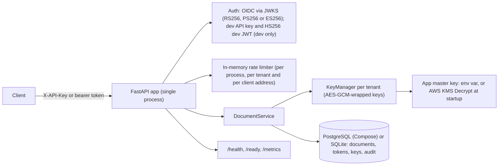

There is no Redis, HSM, blob storage, TEE, SIEM or TLS termination in this repository. The
application runs as one process. The per-tenant key cache is safe across processes: it reloads keys
from the database before every ingest and search and loads unknown key IDs on demand ([#39]). Rate
limiting is in memory and per process (bounded GCRA buckets per tenant and operation, plus a
per-client-address limit), so a multi-replica deployment still needs an external limiter
([#47]).

### Durable document and RAG workflow

1. `POST /v1/documents` authenticates the caller and resolves its tenant.
   - It encrypts the content with AES-256-GCM under the tenant's document key.
   - It extracts keywords, or accepts the ones supplied, and stores one
     `HMAC-SHA256(tenant search key, keyword)` token per keyword. Keywords are lowercased and
     stripped of surrounding punctuation; extracted keywords shorter than three characters and
     stop words are dropped, and one document yields at most 10,000.
   - Request limits: `doc_id` is 1 to 128 of `A-Z a-z 0-9 . _ -` and cannot start with `.`;
     at most 256 explicit keywords of up to 128 characters; at most 32 metadata keys and 16 KB of
     metadata JSON.
   - It writes a sanitized audit row in the same transaction. A duplicate `doc_id` returns 409.
2. `POST /v1/documents/search` recomputes the query tokens under every non-destroyed search key of
   the tenant and returns the matching document IDs, their metadata and a score: the number of
   distinct query keywords matched. `AND` requires every keyword.
3. `GET /v1/documents/{doc_id}` decrypts one document that belongs to the caller's tenant.
4. `DELETE /v1/documents/{doc_id}` deletes a document and its tokens in one transaction (write or
   admin role; audit event `document.delete`).
5. `POST /v1/rag/retrieve` returns ranked candidates for downstream RAG context assembly.
   - Plaintext is included only when `include_plaintext` is true.
   - It does not generate embeddings or call an LLM.

Key reads on these paths do not write to the database: only ingest (and key creation) and delete
write, plus one audit row per request. These routes persist across restarts. The Docker Compose smoke flow in
[CTO_DEMO_SCRIPT.md](CTO_DEMO_SCRIPT.md) demonstrates this.

### Other routes

These are the only routes besides the five above. The in-memory demo routes (`/v1/encrypt`,
`/v1/decrypt`, `/v1/search/*`, `/v1/keys*`) were removed in [#36].

| Route | Backing | Note |
| --- | --- | --- |
| `GET /health`, `GET /ready` | Process state; database, migration, auth and key-provider checks | `/ready` is unauthenticated and returns pass/fail booleans; failure details go to the log ([#41]). |
| `GET /metrics` | Per-process Prometheus registry | Labels are route templates, methods and status codes, never document IDs. Optional bearer token ([#43]). |

### Storage

Four Alembic migrations create the five tables (the second drops a soft-delete flag that was never
set, because documents are hard-deleted; the third adds the sealed-metadata column; the fourth adds
the audit chain):

| Table | Contents |
| --- | --- |
| `encrypted_ir_documents` | Sealed content and sealed metadata (ADR-007), format, key IDs, token count. Legacy rows keep plaintext `metadata_json`. |
| `encrypted_ir_document_tokens` | `(tenant_id, token, doc_id)` keyword-token rows |
| `encrypted_ir_keys` | Per-tenant keys wrapped under the app master key, plus metadata |
| `encrypted_ir_audit_log` | Audit entries in one schema (API events, rejections and key events), chained per tenant by `seq`, `prev_hash` and `entry_hash` (ADR-017). Rows from before migration 0004 stay unchained. |
| `encrypted_ir_audit_chain_heads` | Each tenant's last `seq` and hash. Its row lock serializes a tenant's appends. |

Tenant isolation is enforced in application code: every query filters on `tenant_id`. There is
no row-level security in the database.

### Keys

- **App master key.** One per deployment. In dev it is read from `ENCRYPTED_IR_MASTER_KEY_B64`
  (Compose sets a demo value); if unset, a random key is generated and lost on restart.
- **Production key source.** Production settings require `ENCRYPTED_IR_KMS_PROVIDER=aws`, and
  the master key is unwrapped once at startup with AWS KMS `Decrypt`, pinned to the configured key
  and the encryption context `{application, environment, purpose: app-master-key}`.
- **Tenant keys.** Each tenant has a document-encryption key and a search key. Both are created
  on first use and stored wrapped under the master key, bound to the tenant, key ID, type and
  version ([#40]).
- **Rotation.** The library can create new key versions and keep retired keys decryptable.
  Stored documents are not re-encrypted ([#42]).

### Where the primitives are used

| Primitive | Durable path (API) | Library, examples or tests only |
| --- | --- | --- |
| AES-256-GCM + HMAC keyword tokens (`SearchableEncryption`) | Yes | |
| AES-SIV (`DeterministicEncryption`) | | Yes |
| Blind index | | Yes (`examples/portfolio_demo.py`) |
| ORE (CLWW-style prototype, `encrypted_ir.research.ore`) | | Yes (`examples/portfolio_demo.py`) |
| FF1, CKKS, ML-KEM/ML-DSA, differential privacy, forward- and backward-private SSE | | Yes (`encrypted_ir.research`) |

The leakage of each primitive is in [THREAT_MODEL.md](THREAT_MODEL.md).

---

## Target state (not implemented)

> Everything under this heading is the original target-state design, written in 2025. It is kept
> as reference for later phases. **None of it describes the current code.** Components such as
> HSM, CloudHSM, Redis, multiple API replicas, blob storage, TEE, PIR, BFV and SIEM integration
> do not exist in this repository. See [ROADMAP.md](ROADMAP.md) for what is planned and what is
> explicitly not planned.

### Overview (target)

#### Design Principles

1. **Defense in Depth**: Multiple encryption layers with different security/performance trade-offs
2. **Crypto-Agility**: Algorithm identifiers in ciphertext headers; support for migration
3. **Explicit Leakage**: Document what each primitive leaks; provide alternatives (PIR, TEE)
4. **Auditability**: Comprehensive logging of all cryptographic operations
5. **Compliance-First**: Design mapped to DORA, PCI DSS v4.0.1, NYDFS, GDPR

#### High-Level Architecture

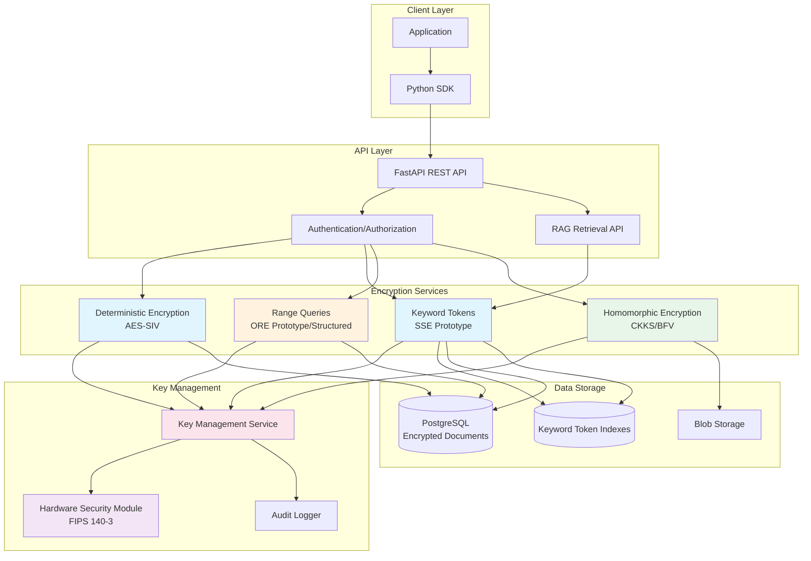

---

### System Components

#### 1. Encryption Modules

##### 1.1 Deterministic Encryption (AES-SIV)

**Purpose**: Equality searches on account numbers, customer IDs, SSNs

**Properties**:
- Misuse-resistant AEAD (nonce reuse safe)
- Deterministic: same plaintext → same ciphertext
- 512-bit keys (AES-256-SIV)

**Usage**:
```python
from encrypted_ir import DeterministicEncryption

encryptor = DeterministicEncryption()
ciphertext = encryptor.encrypt("ACC-12345")
# Same plaintext always produces same ciphertext
```

**Leakage**: Equality patterns, frequency distribution

##### 1.2 Blind Indexes (HMAC-SHA256)

**Purpose**: Equality searches with reduced leakage

**Properties**:
- HMAC-based indexes with per-tenant salts
- Collision-resistant (2^128 security)
- No direct ciphertext determinism

**Architecture**:
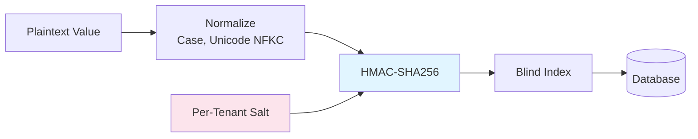

**Leakage**: Scoped equality (within tenant), bounded frequency

##### 1.3 Searchable Encryption (DSSE)

**Purpose**: Keyword search on encrypted documents/emails

**Properties**:
- Forward privacy: updates unlinkable to past queries
- Replay protection via nonces
- Optional PIR mode for zero-leakage

**Index Structure**:
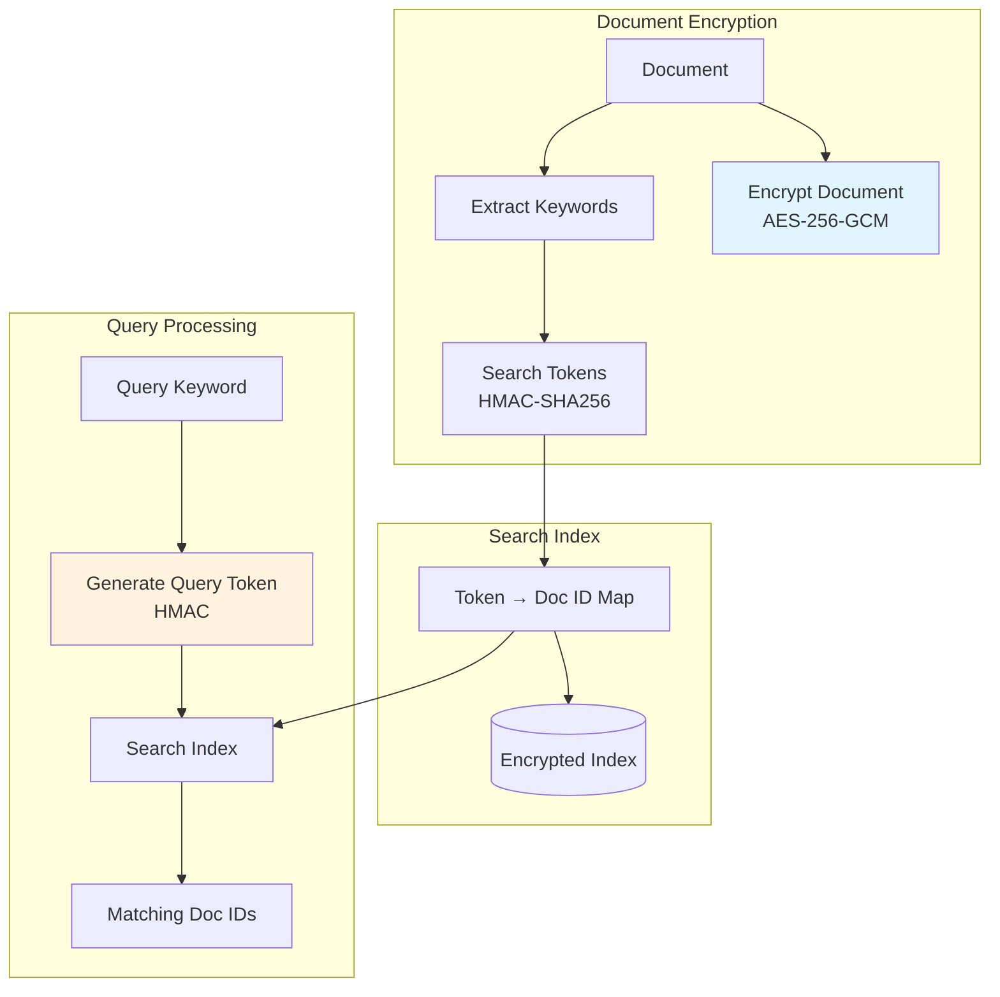

**Leakage**: Search patterns, access patterns, result sizes

##### 1.4 Range Queries (ORE/Structured Encryption)

**Purpose**: Range queries on transaction amounts, dates

**Current**: OPE (simplified PRF-based)
**Target**: Lewi-Wu ORE or bucketed B-tree with padding

**ORE Upgrade Architecture**:
```mermaid
graph TB
    subgraph "Current: OPE (HIGH LEAKAGE)"
        OPE_IN[Plaintext Value] --> OPE_MAP[PRF-based Mapping]
        OPE_MAP --> OPE_OUT[Order-Preserving Ciphertext]
        OPE_OUT -.->|"Leaks: Full order + distribution"| LEAK1[❌ High Leakage]
    end

    subgraph "Target: ORE (REDUCED LEAKAGE)"
        ORE_IN[Plaintext Value] --> ORE_COMP[Lewi-Wu Comparator]
        ORE_COMP --> ORE_CT[ORE Ciphertext]
        ORE_CT -.->|"Leaks: Order only"| LEAK2[⚠️ Moderate Leakage]
    end

    subgraph "Alternative: Structured Encryption"
        SE_IN[Plaintext Value] --> BUCKET[Assign to Bucket]
        BUCKET --> TREE[Encrypted B-Tree]
        TREE --> FILTER[Client-Side Post-Filter]
        FILTER -.->|"Leaks: Bucket access"| LEAK3[⚠️ Moderate Leakage]
    end

    style OPE_MAP fill:#ffcdd2
    style ORE_COMP fill:#fff3e0
    style TREE fill:#e8f5e9
```

**Leakage**: Order (ORE), bucket access (structured encryption)

##### 1.5 Homomorphic Encryption (CKKS/BFV)

**Purpose**: Encrypted computation for credit scoring, analytics

**Properties**:
- IND-CPA security under RLWE/LWE
- SIMD batching for performance
- Large ciphertexts (100KB+ per vector)

**Computation Flow**:
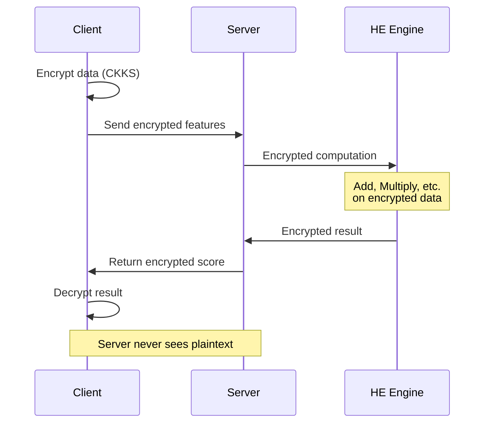

**Leakage**: Model structure, computation timing, result sizes

---

### Data Flow Diagrams

#### Equality Search Flow (Blind Index)

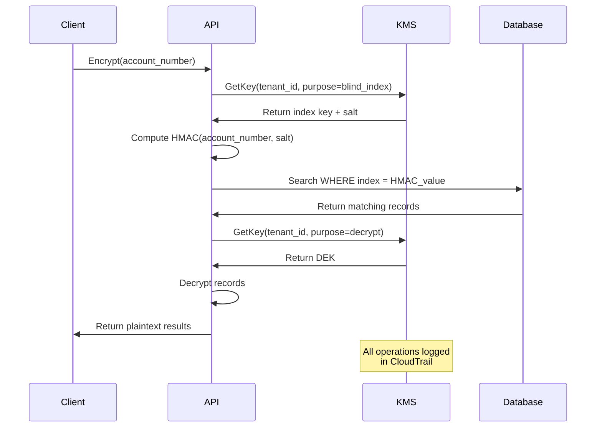

#### Document Encryption & Search Flow

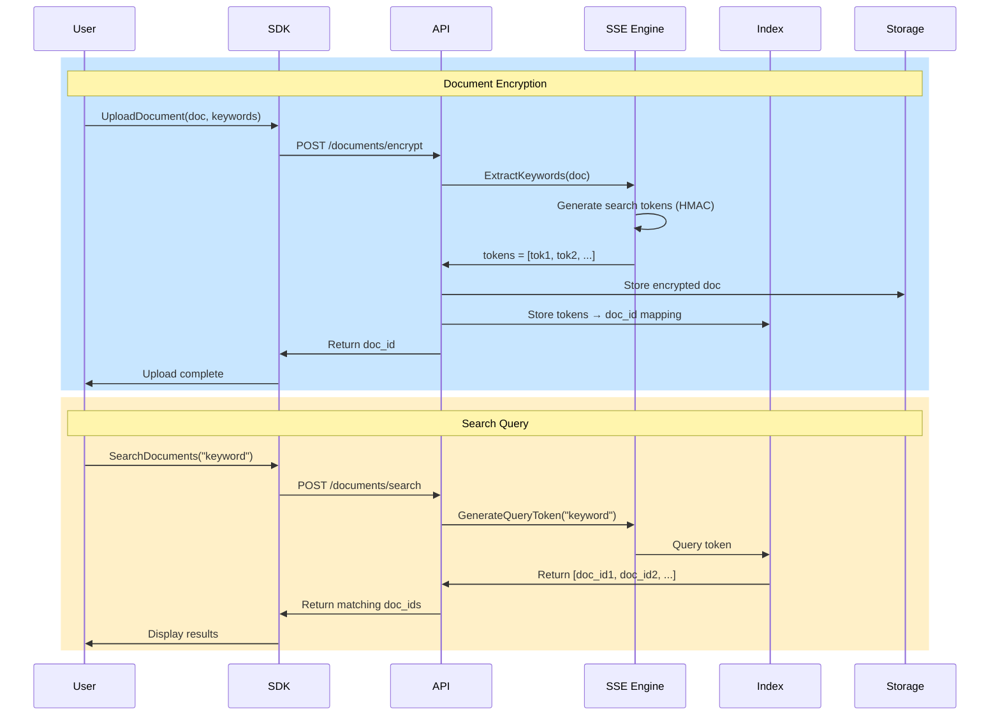

#### Range Query Flow (ORE)

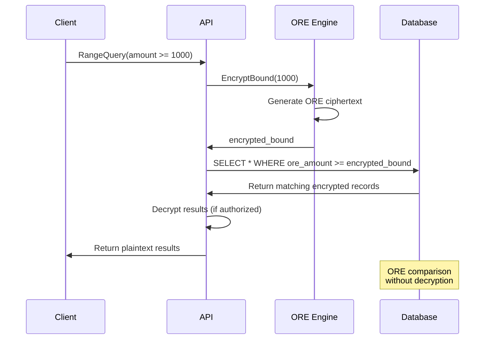

---

### Encryption Patterns

#### Pattern 1: Envelope Encryption (KEK/DEK)

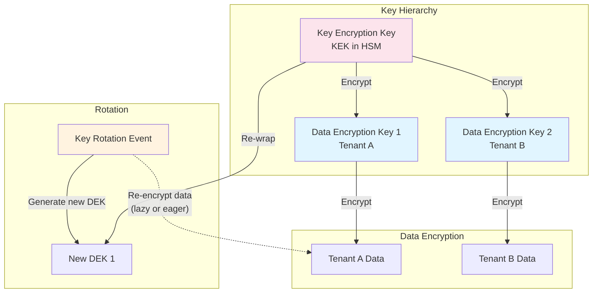

**Benefits**:
- KEK never leaves HSM
- DEK rotation without KEK change
- Per-tenant key isolation

#### Pattern 2: Hybrid Multi-Layer Encryption

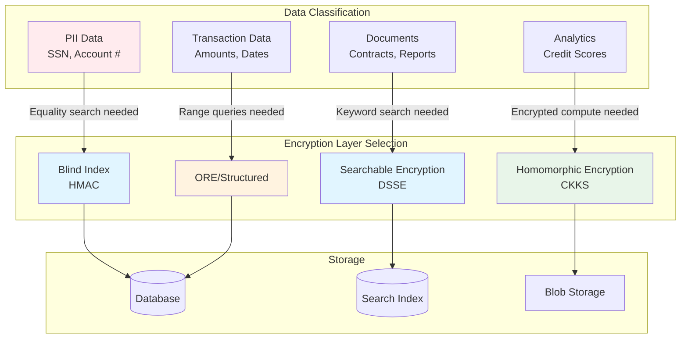

---

### Key Management Architecture

#### KMS Integration (AWS KMS Example)

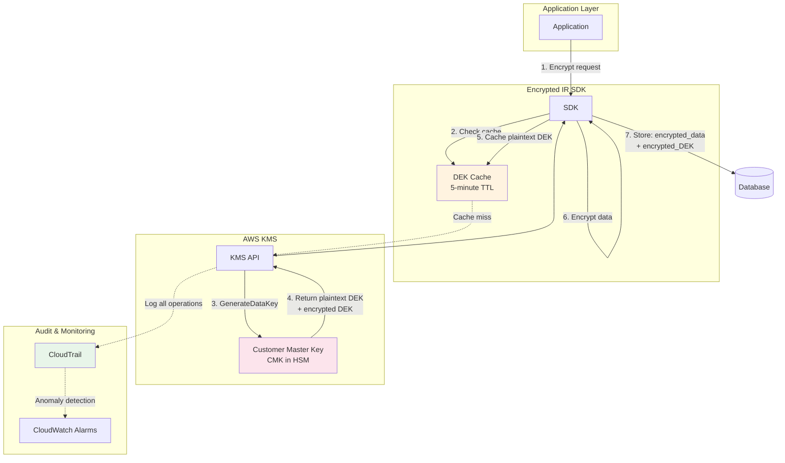

#### Key Rotation Process

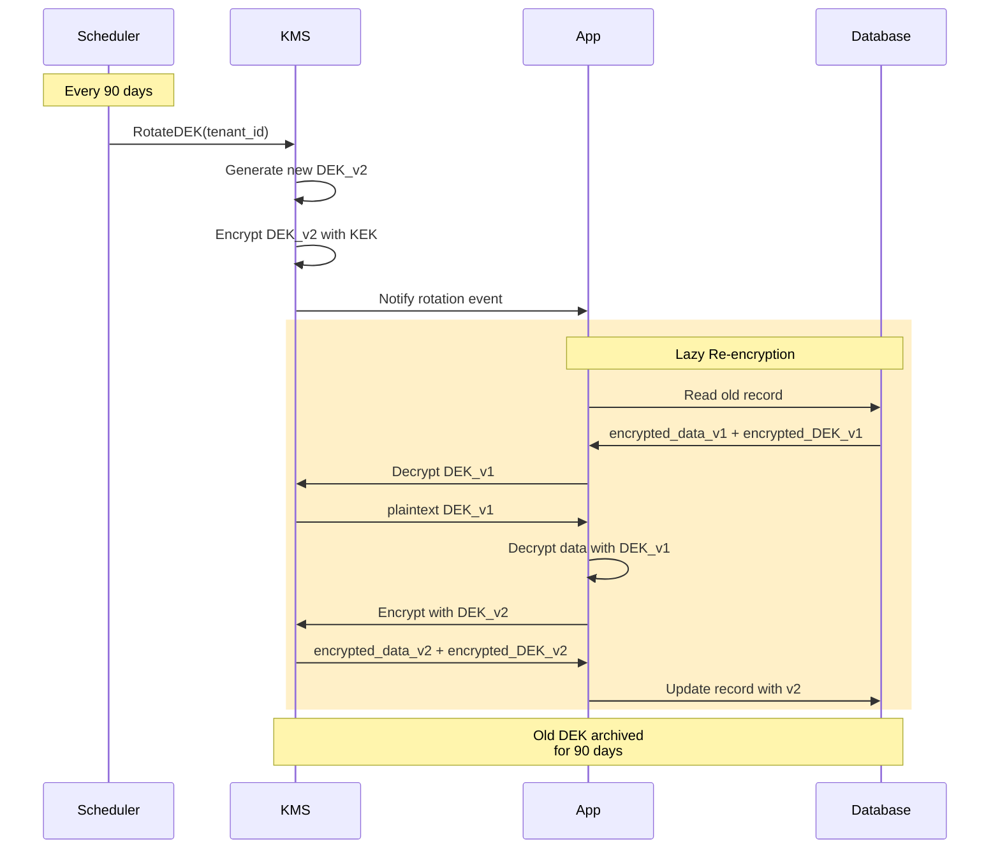

---

### Deployment Models

#### Model 1: Cloud-Native (AWS Example)

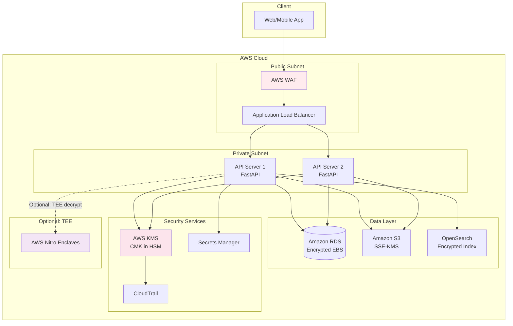

#### Model 2: On-Premises with HSM

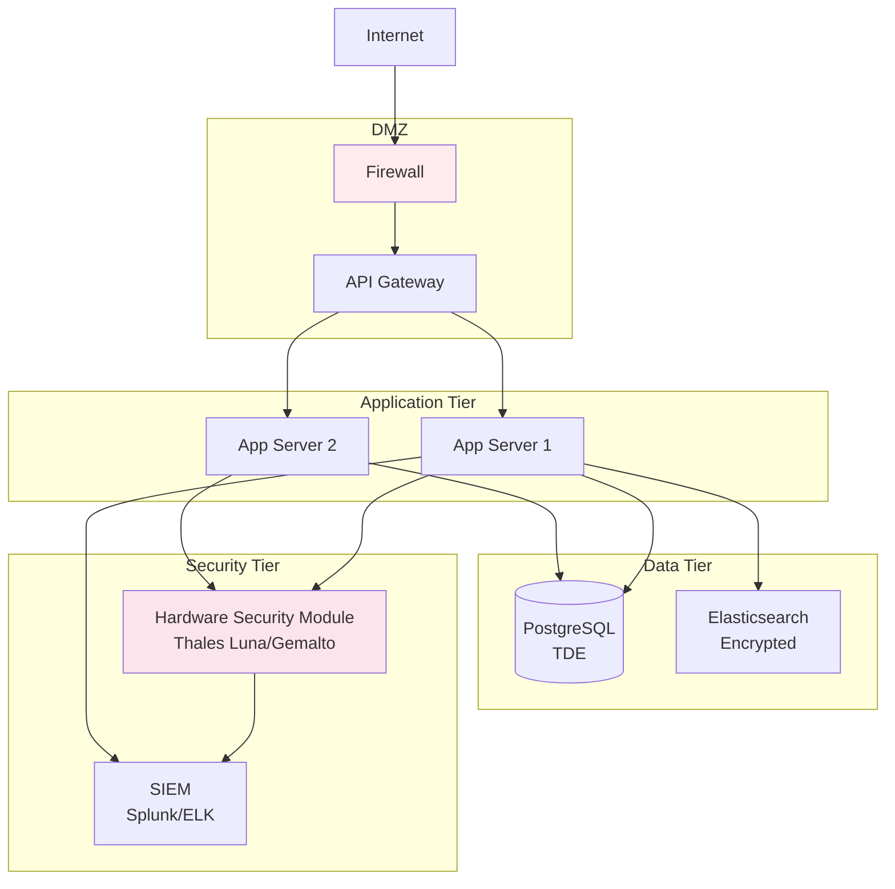

---

### Performance Characteristics

Earlier versions of this document listed latency and throughput estimates that were never measured. They were removed. Measured numbers, and how they were produced, are in [`benchmarks/reports/`](../benchmarks/reports/) and [PORTFOLIO_EVIDENCE.md](PORTFOLIO_EVIDENCE.md).

---

### Security Boundaries

#### Trust Boundaries

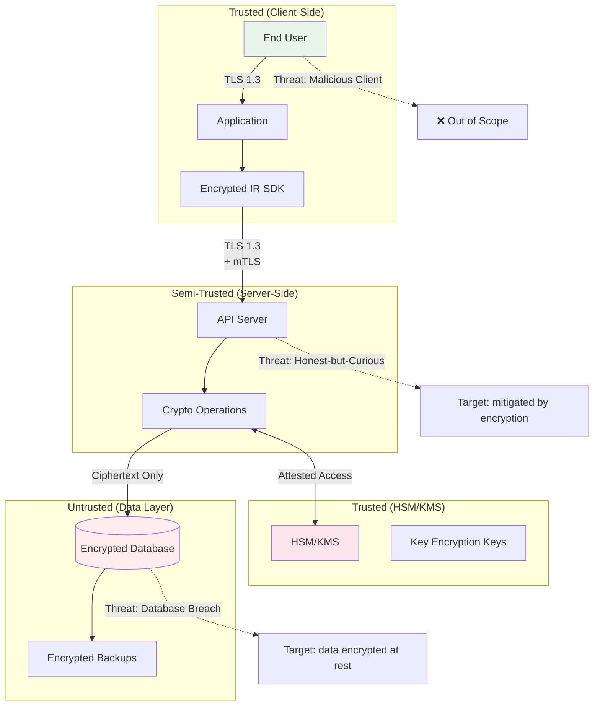

#### Attack Surface

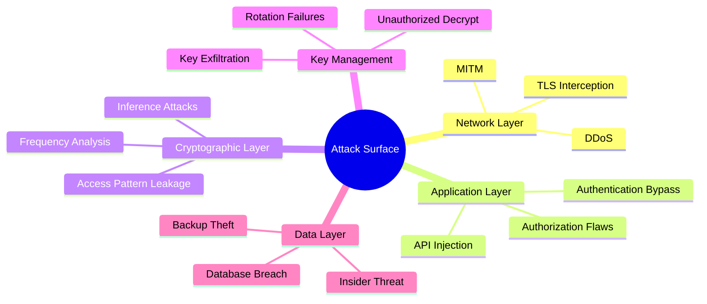

---

### Scaling Considerations

The API holds two kinds of per-process state: the rate-limit buckets and the Prometheus
registry. The key cache is safe across processes ([#39]). Running more than one process (uvicorn
workers or replicas) therefore needs:

- an external rate limiter in front of the API, because each process enforces the configured
  limits on its own, so N processes allow N times the limit ([#47]);
- a Prometheus scrape per process (or one worker per container, as the Docker image runs).

The database is a single PostgreSQL instance. Sharding, a shared cache and multi-region KMS are
not designed here.

---

## References

1. NIST SP 800-57, "Key Management Recommendations"
2. AWS Architecture Well-Architected Framework
3. Microsoft SEAL Documentation
4. RFC 5297, "Synthetic Initialization Vector (SIV)"
5. Lewi & Wu, "Order-Revealing Encryption", 2016

[#36]: https://github.com/MysterionRise/encrypted-information-retrieval/issues/36
[#39]: https://github.com/MysterionRise/encrypted-information-retrieval/issues/39
[#40]: https://github.com/MysterionRise/encrypted-information-retrieval/issues/40
[#41]: https://github.com/MysterionRise/encrypted-information-retrieval/issues/41
[#42]: https://github.com/MysterionRise/encrypted-information-retrieval/issues/42
[#43]: https://github.com/MysterionRise/encrypted-information-retrieval/issues/43
[#47]: https://github.com/MysterionRise/encrypted-information-retrieval/issues/47
